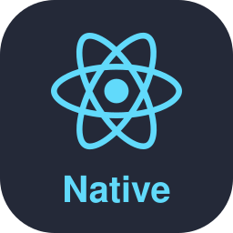
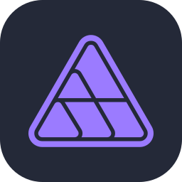

### Hi, I'm Zafar Ali

I help enterprises modernize at scale: 
AI agents and the harnesses that make them reliable, 
the platforms teams ship on, and software that stays fast. 
I help teams adopt AI that works, through trainings &amp; workshops.

 

 

 

  

